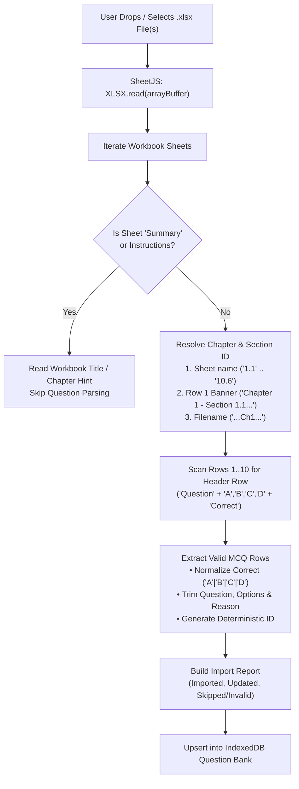

# Phase 2: Excel Upload, Smart Extractor & Question Bank Manager

## 1. Objective
Build a resilient, zero-friction **Excel (`.xlsx` / `.xls`) Upload & Extraction Pipeline** specifically engineered for NEC ASoE workbooks like `NEC_ASoE_Ch1_Fundamentals_of_IT_180_MCQs.xlsx` (as well as Chapters 2–10 workbooks and generic MCQ spreadsheets), paired with a **Question Bank Explorer** where users can inspect uploaded coverage per chapter and section without spoiling answers.

---

## 2. Extraction Pipeline Architecture

---

## 3. Detailed Parsing Rules (`src/lib/excel-parser.ts`)

### 3.1 Section & Chapter Auto-Detection
1. **Exact Section Tab Match**: If sheet name trimmed matches `/^(\d{1,2})\.(\d{1,2})$/` (e.g., `1.1`, `1.6`, `4.3`, `10.2`), extract `sectionId = "1.1"` and `chapterNumber = 1`, then attach official NEC metadata (`ASoE0101`, `"Introduction to Information Technology"`).
2. **Banner Row Match**: If sheet Row 1 contains `"Chapter X - Section X.Y"` (exact pattern in `NEC_ASoE_Ch1_Fundamentals_of_IT_180_MCQs.xlsx`), extract `chapterNumber` and `sectionId` from the banner.
3. **Row-Level Columns (Single-Sheet Excel Support)**: Check optional columns `Chapter`, `Section`, `Topic`, or `Code` (`ASoE0101`) on each row.
4. **Filename Hint / Manual Fallback**: Parse `Ch1`, `Chapter_2`, etc. from filename, or allow user to pick a default Chapter/Section in the upload preview modal if a custom spreadsheet lacks section metadata.

### 3.2 Flexible Column Header Normalization
Scan the first 10 rows of a sheet to find the header row (in `NEC_ASoE_Ch1_Fundamentals_of_IT_180_MCQs.xlsx`, Row 1 is a banner and **Row 2** is the header):
- **Number (`originalNo`)**: `no`, `s.n`, `sn`, `q.no`, `id`, `#`
- **Question (`question`)**: `question`, `questions`, `prompt`, `statement`, `stem`
- **Option A (`options.A`)**: `a`, `option a`, `opt a`, `(a)`
- **Option B (`options.B`)**: `b`, `option b`, `opt b`, `(b)`
- **Option C (`options.C`)**: `c`, `option c`, `opt c`, `(c)`
- **Option D (`options.D`)**: `d`, `option d`, `opt d`, `(d)`
- **Correct Answer (`correctOption`)**: `correct`, `correct answer`, `answer`, `ans`, `key`, `right option`
  - Normalizes values like `"D"`, `"Option D"`, `"(D)"`, `"d"` -> `'D'`. Also handles cases where the cell contains the exact text of one of the options.
- **Explanation (`reason`)**: `reason / explanation`, `reason`, `explanation`, `rationale`, `solution`, `why`
  - Fallback if blank: `"Correct answer is Option <X>."` (flagged as missing reason in upload warnings so user knows).
- **Ignored Columns**: `your answer`, `result`, `score` (Excel interactive self-test columns `G` and `H` are safely ignored).

### 3.3 Deduplication Strategy
Each extracted question generates a deterministic key:
`id = slug(sectionId) + "-" + hash(normalizeText(question))`
Re-uploading `NEC_ASoE_Ch1_Fundamentals_of_IT_180_MCQs.xlsx` updates existing questions cleanly instead of creating duplicate questions!

---

## 4. UI Components (`src/app/upload/page.tsx`)

1. **Multi-File Drag & Drop Zone**:
   - Accepts multiple `.xlsx`, `.xls`, `.csv` files at once (so the user can drop Ch1 through Ch10 workbooks together).
   - Built-in **"Load Sample Chapter 1 (180 MCQs)"** quick-action button (optional convenience if bundled) alongside custom file upload.
2. **Instant Extraction Report Card**:
   - Displays workbook name, sheets processed (`1.1`–`1.6`), total questions extracted (`180`), breakdown per syllabus section, and any row warnings (e.g., missing option or invalid answer key).
3. **Uploaded Workbooks & Question Bank Manager**:
   - List of uploaded Excel files with question count, chapters covered, upload date, and **"Remove Workbook"** / **"Clear Bank"** controls.
   - **Spoiler-Safe Question Preview**: Browse extracted questions by Chapter/Section with answers & reasons **hidden behind a toggle** by default so students don't accidentally spoil upcoming exams.

---

## 5. Acceptance Criteria (Definition of Done)
- [ ] Uploading `NEC_ASoE_Ch1_Fundamentals_of_IT_180_MCQs.xlsx` extracts **all 6 sections (`1.1`–`1.6`)** and **all 180 MCQs** with 100% accuracy on options `A–D`, `Correct`, and `Reason / Explanation`.
- [ ] Summary sheet (`Summary`) and Row 1 banner rows are cleanly skipped without false-positive errors.
- [ ] Re-uploading the same Excel file performs idempotent upsert (still `180` unique questions, `0` duplicates).
- [ ] Uploaded questions immediately reflect in Chapter 1 (`ASoE01`) syllabus coverage counters (`30` per section `1.1`–`1.6`).

