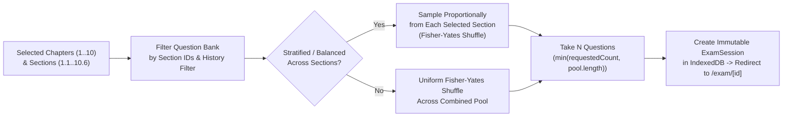

# Phase 3: Chapter-Wise & Section-Wise Question Generator

## 1. Objective
Build the **NEC Exam & Chapter-Wise Question Generator** (`/generator`) allowing students to generate realistic exams or targeted topic drills across any combination of the **10 NEC Software Engineering (`ASoE`) Chapters** and **60 Sub-sections**, using the questions extracted from uploaded Excel files.

---

## 2. Generator Capabilities & Presets

### 2.1 Quick Exam Presets
1. **Chapter Drill**: Pick an entire chapter (e.g., *Chapter 1: Fundamentals of Information Technology — 180 Available*) and generate 20 / 30 / 50 / All questions.
2. **Sub-Section Focus**: Pick one or more specific syllabus sub-sections (e.g., `1.4 Computer Networks` + `1.5 Data Communication` = 60 pool) to master weak areas.
3. **NEC Full Mock Exam Mode**:
   - Standard NEC Registration Exam simulation (`100 MCQs`, `120 Minutes` countdown timer, balanced proportional sampling across available chapters).
4. **Smart Weak-Spot / Unseen Filter**:
   - **All Questions in Scope** (default)
   - **Unattempted Questions Only** (prioritize questions never answered before)
   - **Previously Wrong Questions Only** (targeted mistake remediation)

---

## 3. Selection & Sampling Algorithm (`src/lib/exam-generator.ts`)

### Key Generator Configuration Controls
| Setting | Options | Default | Purpose |
| :--- | :--- | :--- | :--- |
| **Syllabus Scope** | Multi-select Accordion Tree (`Ch 1`–`Ch 10`, `1.1`–`10.6`) | All chapters with >0 uploaded questions | Shows badge with exact uploaded question count per chapter & section; disables empty sections clearly. |
| **Number of Questions** | `10`, `20`, `30`, `50`, `100`, `All`, or Custom Slider/Input | `30` (or `min(30, poolSize)`) | Dynamically capped to available pool size. |
| **Question Order** | `Randomized (Shuffled)` / `Sequential (Sheet Order)` | `Randomized` | Prevents memorizing row order from Excel. |
| **Section Balancing** | `Balanced across selected sections` / `Pure random` | `Balanced` | Ensures e.g. a 30-question Chapter 1 test pulls ~5 questions from each of `1.1`–`1.6`. |
| **Exam Timer** | `Untimed`, `15m`, `30m`, `60m`, `120m (NEC Standard)`, Custom | `30m` (1 min/question) or `Untimed` | Simulates real exam time pressure when enabled. |

---

## 4. UI Layout (`src/app/generator/page.tsx`)

- **Left / Main Column — Interactive NEC Syllabus Tree**:
  - Grouped by NEC Syllabus parts (*Part I: Fundamentals Ch 1–4*, *Part II: Engineering Practice Ch 5–9*, *Part III: Project Planning Ch 10*).
  - Each Chapter card has:
    - Checkbox (selects/deselects all populated sub-sections in that chapter).
    - Official NEC code badge (e.g., `ASoE01`, `ACtE08`).
    - Available question count pill (e.g., `180 MCQs Ready` in emerald, or `0 Uploaded — Upload Excel` link in muted slate).
    - Expandable sub-section rows (`1.1` to `1.6`) with individual checkboxes, syllabus code (`ASoE0101`), and section count (`30 MCQs`).
- **Right Sticky Panel — Exam Summary & Launch Card**:
  - Live summary: *"Selected: 1 Chapter, 6 Sections • Pool: 180 Questions"*.
  - Question count selector, shuffle toggle, timer selector, custom session title.
  - Primary CTA: **"Start Exam Now"** -> creates `ExamSession` and routes to `/exam/[sessionId]`.

---

## 5. Acceptance Criteria (Definition of Done)
- [ ] Chapters and sections accurately display real-time counts from the uploaded Excel question bank.
- [ ] Selecting specific sub-sections (e.g., only `1.2 Storage System` and `1.4 Computer Networks`) generates questions **strictly** from `1.2` and `1.4`.
- [ ] Balanced sampling distributes questions evenly across selected sections using unbiased Fisher-Yates shuffling.
- [ ] Empty chapters/sections cannot produce empty exams; clear guidance links directly to `/upload` to add missing chapter workbooks.

