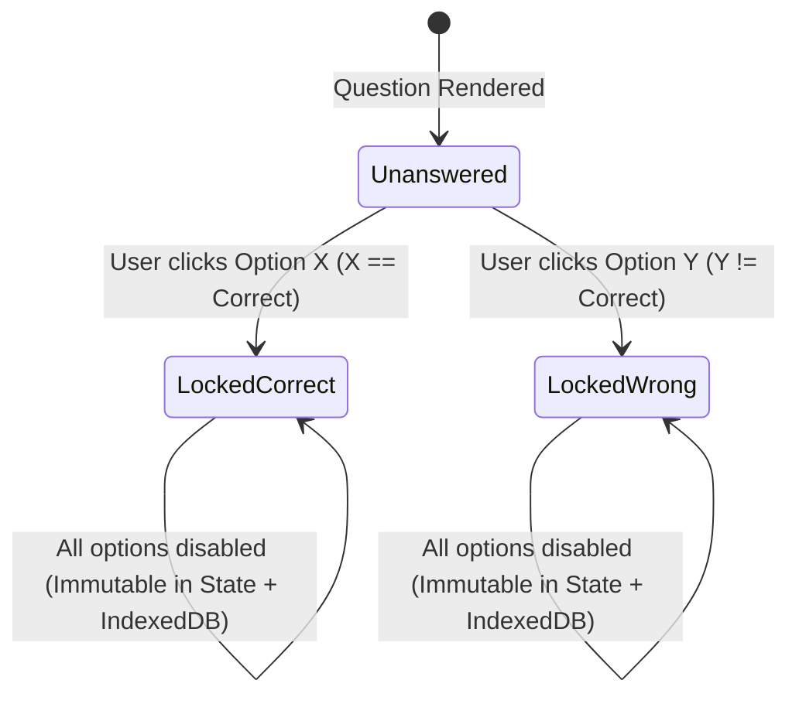

# Phase 4: Interactive MCQ Exam Engine (Option Lock & Instant Reason Reveal)

## 1. Objective
Deliver an exam-grade, distraction-free **Interactive MCQ Assessment Runner** (`/exam/[sessionId]`) implementing the user's two core behavioral rules with zero loopholes:
1. **Permanent Single-Choice Lock**: Once the user clicks an option (`A`, `B`, `C`, or `D`) on a question, **that question is immediately locked** — no other option can be clicked, changed, or undone, even after navigating away and returning or refreshing the browser.
2. **Instant Feedback with Valid Reason**:
   - When the user chooses a **Wrong Option**: mark the chosen option **Red (`Wrong`)**, immediately highlight the **Correct Option in Green (`Correct Answer`)**, and reveal the **`Reason / Explanation`** panel underneath so the user understands *why*.
   - When the user chooses the **Correct Option**: mark the chosen option **Green (`Correct`)** and reveal the **`Reason / Explanation`** panel to reinforce understanding.

---

## 2. Question State Machine

### Strict Lock Enforcement (3-Layer Guarantee)
1. **UI Layer**: The moment `answers[question.id]` exists, every `<OptionButton />` receives `disabled={true}` and `aria-disabled="true"` with `pointer-events-none`, plus a `"Locked"` badge on the question header.
2. **State Reducer Layer**: `handleSelectOption(questionId, optionKey)` checks `if (session.answers[questionId]) return;` — any duplicate click or keyboard shortcut is a strict no-op.
3. **Persistence Layer (`IndexedDB`)**: `lockQuestionAnswer(sessionId, questionId, record)` writes atomically to IndexedDB only if `session.answers[questionId]` is `undefined`. Reloading the page restores the exact locked choices, visual states, and timer progress.

---

## 3. Visual States for Options & Explanation Card

### 3.1 Option Button States (`A`, `B`, `C`, `D`)
| Question State | Option Role | Visual Styling | Icon / Badge |
| :--- | :--- | :--- | :--- |
| **Unanswered** | Any Option `A–D` | Neutral card, crisp border, hover highlight (`hover:border-blue-500 hover:bg-blue-50/50`) | Letter badge `A` / `B` / `C` / `D` |
| **Locked — Wrong Choice** | **User's Chosen Option** | **Red border & soft red background** (`border-red-500 bg-red-50 dark:bg-red-950/30`) | `XCircle` + `"Your Choice (Wrong)"` |
| **Locked — Wrong Choice** | **Actual Correct Option** | **Green border & soft emerald background** (`border-emerald-500 bg-emerald-50 dark:bg-emerald-950/30`) | `CheckCircle2` + `"Correct Answer"` |
| **Locked — Wrong Choice** | Other Unchosen Distractors | Muted / dimmed (`opacity-55 border-slate-200`) | Locked |
| **Locked — Correct Choice** | **User's Chosen Option** | **Green border & soft emerald background** (`border-emerald-500 bg-emerald-50 dark:bg-emerald-950/30`) | `CheckCircle2` + `"Correct!"` |
| **Locked — Correct Choice** | Other Unchosen Distractors | Muted / dimmed (`opacity-55 border-slate-200`) | Locked |

### 3.2 Instant Explanation / Reason Card (`<ReasonBanner />`)
Rendered immediately below options as soon as the question enters `LockedCorrect` or `LockedWrong`:
- **Header**:
  - If Wrong: `"Incorrect — You selected Option B. The correct option is Option D."`
  - If Correct: `"Correct! Option D is the right answer."`
- **Body**: Displays `question.reason` (extracted from Column `J: Reason / Explanation` in the Excel sheet), styled for fast comprehension alongside the syllabus tag (e.g., `1.1 • ASoE0101 — Introduction to Information Technology`).

---

## 4. Exam Workspace Layout & Ergonomics

1. **Top Exam Bar**:
   - Exam title & syllabus badge.
   - Live counters: **Answered (`12/30`)**, **Correct (`9`)**, **Wrong (`3`)**, **Remaining (`18`)**.
   - **Countdown Timer** (if timed; auto-submits exam when `00:00` is reached) or **Elapsed Stopwatch** (if untimed).
   - **"Finish & View Result"** button (prompts confirmation if unanswered questions remain, showing exact count of skipped questions).
2. **Center Question Stage**:
   - Question number (`Question 7 of 30`), Syllabus Section pill (`1.4 Computer Networks • ASoE0104`), and Lock status badge (`Select once — locks immediately` vs `Answer Locked`).
   - Clear typography for the question prompt and options `A`, `B`, `C`, `D`.
   - Instant `<ReasonBanner />` upon selection.
   - **Previous / Next Question** navigation + **"Next Unanswered"** shortcut.
3. **Right / Collapsible Question Palette Navigator**:
   - Grid of numbered tiles (`1`..`N`) color-coded in real time:
     - **Emerald**: Locked & Correct
     - **Rose/Red**: Locked & Wrong
     - **Slate Outline**: Unanswered
     - **Blue Ring**: Currently viewing
4. **Keyboard Accessibility**:
   - Keys `A`/`B`/`C`/`D` (or `1`/`2`/`3`/`4`) lock the corresponding option if unanswered.
   - `ArrowLeft` / `ArrowRight` (or `N` / `P`) navigate between questions.

---

## 5. Acceptance Criteria (Definition of Done)
- [ ] Clicking an option immediately locks all four options on that question; clicking another option or pressing `A–D` keys afterward has **zero effect**.
- [ ] Refreshing the browser mid-exam preserves every locked answer, timer value, and locked visual state.
- [ ] Selecting a wrong option highlights the wrong choice in Red, simultaneously highlights the right choice in Green, and displays the full `Reason / Explanation` text from the Excel sheet.
- [ ] Submitting the exam (manually or via timer expiry) transitions `status = 'completed'` and navigates to `/results/[sessionId]`.

