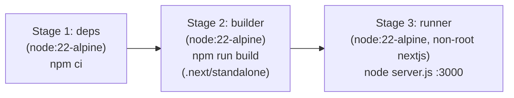

# Phase 6: Docker Containerization, QA & Deployment

## 1. Objective
Package the Next.js MCQ Extractor & Exam Simulator into a lightweight, production-hardened **Docker container** (`Dockerfile` + `docker-compose.yml`) using Next.js `standalone` output, verify all functional requirements end-to-end against `NEC_ASoE_Ch1_Fundamentals_of_IT_180_MCQs.xlsx`, and provide one-command startup instructions.

---

## 2. Container Architecture



### 2.1 Next.js Standalone Configuration (`next.config.ts`)
Enable standalone tracing so the final container ships only minimal production server files instead of the full `node_modules` tree:
```typescript
import type { NextConfig } from 'next';

const nextConfig: NextConfig = {
  output: 'standalone',
};

export default nextConfig;
```

### 2.2 Multi-Stage `Dockerfile`
- **Base Image**: `node:22-alpine`
- **Stage 1 (`deps`)**: Installs dependencies cleanly via `npm ci`.
- **Stage 2 (`builder`)**: Copies source, disables Next telemetry (`NEXT_TELEMETRY_DISABLED=1`), runs `npm run build`.
- **Stage 3 (`runner`)**:
  - Runs as unprivileged user `nextjs:nodejs` (UID `1001`).
  - Copies `public/`, `.next/standalone/`, and `.next/static/`.
  - Exposes `PORT=3000`, binds `HOSTNAME=0.0.0.0`.
  - Starts with `CMD ["node", "server.js"]`.

### 2.3 `docker-compose.yml`
```yaml
services:
  nec-mcq-exam:
    container_name: nec-asoe-mcq-app
    build:
      context: .
      dockerfile: Dockerfile
    ports:
      - "3000:3000"
    environment:
      - NODE_ENV=production
      - NEXT_TELEMETRY_DISABLED=1
      - PORT=3000
      - HOSTNAME=0.0.0.0
    restart: unless-stopped
    healthcheck:
      test: ["CMD", "wget", "--no-verbose", "--tries=1", "--spider", "http://127.0.0.1:3000/api/health"]
      interval: 30s
      timeout: 5s
      retries: 3
      start_period: 10s
```

### 2.4 `.dockerignore`
Excludes `node_modules`, `.next`, `.git`, `.codebuddy`, `*.log`, and local dev artifacts to keep Docker build context fast and clean.

---

## 3. Healthcheck Endpoint (`src/app/api/health/route.ts`)
Lightweight GET endpoint returning `{ status: "ok", service: "nec-asoe-mcq-exam", chapters: 10, sections: 60 }` with HTTP `200` for container orchestration and readiness probes.

---

## 4. End-to-End Quality Assurance Checklist

1. **Excel Parser Unit & Integration Verification**:
   - Test `excel-parser.ts` directly against `NEC_ASoE_Ch1_Fundamentals_of_IT_180_MCQs.xlsx`:
     - Verify `6` sections (`1.1` through `1.6`), `30` questions per section = `180` total questions.
     - Verify every question has non-empty `question`, options `A–D`, `correctOption` in `{'A','B','C','D'}`, and non-empty `reason`.
2. **Exam Lock & Feedback Verification**:
   - Verify clicking a wrong option immediately:
     1. Locks the question permanently (subsequent clicks on any option do nothing; reload preserves lock).
     2. Highlights selected option as **Wrong (Red)** and actual correct option as **Correct (Green)**.
     3. Displays the exact **`Reason / Explanation`** string from the Excel sheet.
3. **Result & Syllabus Breakdown Verification**:
   - Verify score calculation, pass/fail threshold, section-wise (`1.1`–`1.6`) accuracy table, wrong-question filter, and "Retry Wrong Questions" generator.
4. **Build & Docker Verification**:
   - `npm run lint` & `npm run build` pass with zero errors.
   - `docker compose build` & `docker compose up -d` start cleanly and respond HTTP `200` on `http://localhost:3000` and `/api/health`.

---

## 5. Run Commands Reference

### Local Development
```bash
npm install
npm run dev
# Open http://localhost:3000
```

### Docker Container (Production)
```bash
docker compose up --build -d
# Open http://localhost:3000
# Stop container:
docker compose down
```

