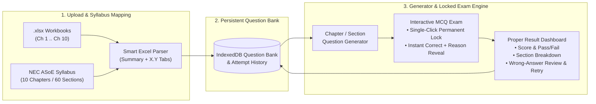
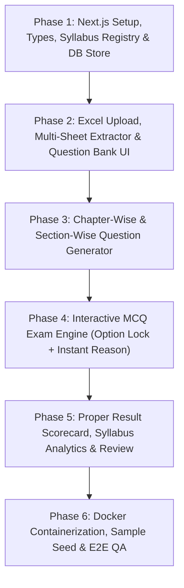

# NEC ASoE Exam & Chapter-Wise MCQ Generator — Documentation & Phases

Welcome to the engineering documentation and phased implementation plan for the **NEC Software Engineering (`ASoE`) Excel MCQ Extractor & Interactive Exam Simulator**.

This project transforms Excel MCQ workbooks (such as `NEC_ASoE_Ch1_Fundamentals_of_IT_180_MCQs.xlsx` and Chapters 2–10 workbooks) into an honest, syllabus-mapped, interactive exam & learning web application powered by **Next.js (React + TypeScript)** and packaged in a **Docker container**.

---

## 1. Core Problem Solved

In static Excel sheets (`1.1` through `1.6`), learners have to manually hide the `Correct` and `Reason / Explanation` columns, type `A/B/C/D` into cells where answers can accidentally be changed, and switch tabs manually without randomized chapter-wise exam generation.

This platform solves every limitation:
1. **Excel Upload & Smart Extraction**: Upload one or multiple `.xlsx` files; automatically extract chapters, sections (`1.1`–`10.6`), questions, options (`A`–`D`), correct option, and detailed `Reason / Explanation`.
2. **Official NEC `ASoE` Syllabus Mapping**: Built-in registry of all **10 Chapters** and **60 Sub-sections** (`ASoE0101` through `AALL1006`) from the Nepal Engineering Council Registration Examination Syllabus.
3. **Chapter-Wise & Section-Wise Question Generator**: Generate custom exams filtered by any combination of Chapters (`Ch 1`–`Ch 10`) and Sections (`1.1`–`1.6`, etc.), custom question counts, randomized order, and optional exam timers.
4. **Strict Single-Choice Lock**: Once an option (`A`, `B`, `C`, or `D`) is clicked on a question, **it is permanently locked for that attempt and cannot be selected or changed again**.
5. **Instant Learning Feedback**:
   - **Wrong Choice**: Marks selected option **Red**, immediately highlights the **Correct Option in Green**, and displays the **Valid Reason / Explanation** card so the student understands *why*.
   - **Correct Choice**: Marks selected option **Green** and displays the **Reason / Explanation** to reinforce the concept.
6. **Proper Exam Result & Syllabus Analytics**: Full scorecard, accuracy percentage, NEC pass/fail benchmark (`50%`), time spent, section-by-section (`1.1`–`10.6`) accuracy breakdown, filterable review of wrong/skipped questions, and one-click **"Retry Wrong Questions"**.
7. **Dockerized Deployment**: Production multi-stage `Dockerfile` + `docker-compose.yml` for one-command execution anywhere.

---

## 2. Technology Stack

| Layer | Choice | Rationale |
| :--- | :--- | :--- |
| **Framework** | **Next.js 15+ (App Router) + React 19** | Modern React architecture, fast routing, standalone Docker build support (`output: 'standalone'`). |
| **Language** | **TypeScript (Strict)** | Type-safe syllabus codes, Excel parser schemas, immutable exam-lock state transitions, and analytics. |
| **Styling & UI** | **Tailwind CSS + Lucide Icons** | Crisp exam-grade UI, accessible high-contrast Correct/Wrong feedback states, responsive desktop/mobile layout. |
| **Excel Engine** | **`xlsx` (SheetJS)** | Fast client/server parsing of `.xlsx` multi-tab workbooks (`Summary` + `1.1`..`10.6` sheets). |
| **Persistence** | **IndexedDB (`idb`) + Local State** | Stores thousands of extracted MCQs across all 10 chapters and past exam attempt history directly in the browser (plus optional server seed loader) with zero external DB setup needed. |
| **Containerization** | **Docker (`node:22-alpine`) + Docker Compose** | Lightweight (~150 MB) standalone production container running on port `3000`. |

---

## 3. High-Level Architecture

---

## 4. Phased Implementation Roadmap

All project phases are documented in detail inside this `docs/` directory:

| Document | Scope & Deliverables |
| :--- | :--- |
| **[`00-SYLLABUS-AND-EXCEL-SPEC.md`](./00-SYLLABUS-AND-EXCEL-SPEC.md)** | Complete verbatim 10-Chapter / 60-Section NEC `ASoE` Syllabus (`ASoE01`–`AALL10`) & exact column/sheet schema of `NEC_ASoE_Ch1_Fundamentals_of_IT_180_MCQs.xlsx`. |
| **[`PHASE-1-PROJECT-SETUP-AND-SYLLABUS-STORE.md`](./PHASE-1-PROJECT-SETUP-AND-SYLLABUS-STORE.md)** | Next.js + TypeScript + Tailwind scaffolding, folder architecture, TypeScript data models, embedded 60-section NEC syllabus constant, and IndexedDB storage layer. |
| **[`PHASE-2-EXCEL-EXTRACTOR-AND-QUESTION-BANK.md`](./PHASE-2-EXCEL-EXTRACTOR-AND-QUESTION-BANK.md)** | Multi-file `.xlsx` drag-and-drop uploader, multi-sheet NEC parser + generic Excel mapper, validation/deduplication summary, and Syllabus Question Bank Explorer UI. |
| **[`PHASE-3-CHAPTER-WISE-EXAM-GENERATOR.md`](./PHASE-3-CHAPTER-WISE-EXAM-GENERATOR.md)** | Chapter & Sub-section (`1.1`–`10.6`) filter tree, question count & shuffle controls, timer modes, NEC Mock Exam presets, and exam session initializer. |
| **[`PHASE-4-INTERACTIVE-MCQ-EXAM-ENGINE.md`](./PHASE-4-INTERACTIVE-MCQ-EXAM-ENGINE.md)** | Exam runner UI, **strict one-time answer lock**, **instant wrong->correct + reason card reveal**, question palette sidebar, timer, keyboard shortcuts, and submission handling. |
| **[`PHASE-5-PROPER-RESULTS-AND-ANALYTICS.md`](./PHASE-5-PROPER-RESULTS-AND-ANALYTICS.md)** | Detailed result scorecard, accuracy & pass/fail metrics, Chapter/Section breakdown table, weak-area diagnostics, answer filter (`Wrong`/`Correct`/`Skipped`), and Retry Wrong Questions flow. |
| **[`PHASE-6-DOCKER-CONTAINERIZATION-AND-QA.md`](./PHASE-6-DOCKER-CONTAINERIZATION-AND-QA.md)** | Next.js `standalone` config, multi-stage `Dockerfile`, `.dockerignore`, `docker-compose.yml`, automated parser/lock tests, and end-to-end verification checklist. |

---

## 5. Recommended Execution Order

